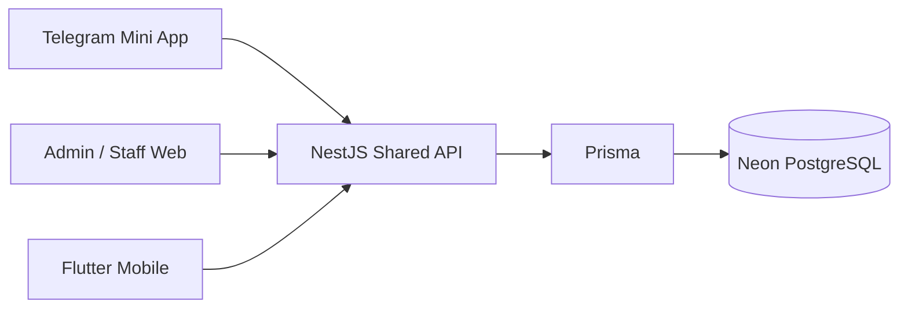

# Architecture

## Status and selected stack

The system implements React/Vite web clients, a shared NestJS API, and Better Auth phone/password authentication. Prisma 7.10.1 with the official Better Auth Prisma adapter accesses Neon PostgreSQL. Prisma Migrate owns auth and business tables. Flutter is developed independently against the same API. Plans, memberships, personal QR APIs, session management, live scanning, check-ins, history, historical backfill and attendance cancellation are implemented. Reports/export, dashboard metrics and hosted/device acceptance remain separate release work.

Start with a modular monolith. Suggested modules: Auth, Users, Plans, Memberships, QR, MeetupSessions, Attendance, Reports, Audit. Do not duplicate business logic by client. Shared TypeScript types do not replace the cross-language API contract consumed by Dart.

## API contract and authentication

Use a versioned REST API, proposed prefix `/api/v1`. Before implementing endpoints, save an OpenAPI contract describing auth, required fields, responses, stable error codes, pagination, dates, retry behavior, and side effects. Maintain an authoritative checked-in OpenAPI artifact; derive documentation and initial Postman requests from it, preserving maintained assertions/examples when regenerating. Implemented paths are documented in the local OpenAPI specification.

Phone/password authentication uses Better Auth's default scrypt hashing through its official Prisma adapter. Web clients use HttpOnly cookies; Flutter uses bearer-compatible database-backed sessions. Public transport behavior is described below. Cookie-authenticated writes require a trusted Origin, and CORS allows explicit origins.

Admin reset/disabling must invalidate existing credentials promptly; stateless tokens alone cannot satisfy immediate revocation without a server-side status/version check. Restrict temporary-password sessions to password replacement. Persist roles and check both role and session assignment on every sensitive operation.

## Data model direction

Core entities: users, auth sessions, plans, memberships with quota snapshots, meetup sessions, staff assignments, member QR credentials, attendance records/corrections, and audit logs. This is not a final Prisma schema.

Use stable IDs and a separate human-readable member number. Enforce normalized-phone uniqueness and membership date validity in PostgreSQL. Exclude cancelled memberships from the no-overlap constraint, as confirmed by the owner. Store membership dates as DATE, event timestamps as TIMESTAMPTZ, and serialize date-only fields as YYYY-MM-DD. Eligibility uses Asia/Yangon, not the deployment server timezone.

Derive remaining visits from effective attendance, or maintain a transactional counter with reconciliation. Use the stored usedVisits counter maintained by the attendance SQL trigger. Quota changes and attendance writes must use the same membership-level serialization discipline.

## Personal QR implementation

QrModule provisions one MemberQr row for every account through an AFTER INSERT trigger, including Admin-created and bootstrap accounts. The additive migration backfills existing users. It stores only a random UUID credentialId, version and updatedAt; no payload, signature or signing key is stored. Membership is not required.

The static payload is `moe:member:v1:<random UUID>:<base64url HMAC-SHA256>`. It contains no user ID, name, phone, dates, quota or login credential. HMAC binds the current credential ID, owning user ID and version using an HKDF-derived, domain-separated key. The key comes from QR_SIGNING_SECRET when provided, otherwise BETTER_AUTH_SECRET. A minimum 32-character secret is required. Configure a dedicated persistent QR_SIGNING_SECRET before production to separate QR validity from auth-secret rotation. Changing this key changes every displayed QR and invalidates previously issued payloads; retain/restore secrets with backups and coordinate key changes. Do not restore an old key as a QR revocation mechanism.

This replaces the earlier encrypted-token proposal: the server reconstructs a signed opaque identifier, so encrypted redisplay material is unnecessary. GET /members/me/qr is authenticated and private/no-store. Admin metadata, regeneration and history never return credential IDs or payloads. Regeneration locks actor/target account rows then the QR row, rechecks live Admin access and version, replaces the random ID, increments version and writes metadata-only audit atomically. Concurrent requests with one version yield one success. A failed response must be resolved by rereading metadata, not an automatic second rotation.

Flutter renders the returned string unchanged; see docs/flutter-qr.md. React provides the Admin/Staff console, member signup and member screens, including the personal QR display. It retains metadata-only Admin regeneration. No payload is placed in URLs, storage, telemetry, audit or logs. Physical camera/device acceptance remains pending.

There is no public QR lookup. The authenticated live check-in transaction must load the current QR row by the parsed random ID, lock/revalidate it against regeneration, verify the HMAC using qrMatches, and separately enforce actor assignment, account status, session date/state and membership quota. Decoding or possessing a QR grants no API access and consumes no visit. An in-flight read can finish with an older snapshot while regeneration commits; the owner refreshes the QR after replacement.

## Attendance consistency

Authenticate and validate permission, then atomically validate current account/session/QR/membership state and create effective attendance. Serialize competing changes on the membership and other relevant mutable authorization/state rows, or use an equivalent correctly isolated strategy with bounded conflict retries. A check-then-write outside a transaction is insufficient.

Enforce one effective attendance per membership/session with an appropriate unique/partial constraint. Cancellation preserves the original record and refunds once; a later valid check-in may create a new effective record. Keep request idempotency records independently so replaying an old request after cancellation does not accidentally create a fresh check-in. A deliberate re-check-in uses a new operation identity.

Return structured business errors; never treat successful QR decoding as successful attendance. On ambiguous network failures retry the same operation identity. Only claim success after backend confirmation. QR rotation, disabling, cancellation, quota edits, and staff assignment changes need defined ordering against in-flight scans.

## Verification

Use real PostgreSQL integration tests for uniqueness, overlap, double scans, different sessions racing for the last visit, quota edits, duplicate cancellation, cancellation/re-check-in, and backfill. Add permission/session-revocation tests, date boundary tests, and device UAT. Use Playwright for web flows and coordinate Flutter contract tests with its team. Avoid storing production credentials/data in test fixtures.

## Better Auth integration — implemented increment

Public endpoints are `/api/v1/auth/signup`, `/login`, `/session`, and `/logout`. Signup/login accept phone/password (signup also name). Phone numbers are validated as Myanmar numbers and normalized to +95. No OTP or verification service is enabled.

Better Auth's email/password credential engine uses a deterministic internal alias `<canonical-digits>@phone.moe.invalid`; this is not a real email, is never verified, and is not exposed by public responses. The actual phone is stored uniquely. Raw Better Auth email/OTP/password-reset routes are not mounted. No email is requested from members. Better Auth owns password hashing (its default scrypt), accounts, sessions, and database-backed rate limits.

Web responses set HttpOnly cookies and do not return tokens in JSON. Mobile callers send `X-MOE-Client: mobile` on writes and receive a signed bearer-compatible session token on signup/login. They store it in native secure storage. Cookie writes require an explicitly allowed Origin; a mobile-header bypass is rejected when cookies are attached. Disabling cookie caching ensures live session checks; disabled accounts cannot create or use a session through these endpoints. Session duration is seven days.

Auth tables retain the `moe_auth_` prefix and all existing physical column, constraint, and index names. Prisma model names AuthUser/AuthAccount/AuthSession/AuthVerification/AuthRateLimit are configured explicitly in Better Auth. Prisma Migrate is the single migration owner. Member profile and personal QR provisioning are implemented.

Still pending: attendance corrections and production deployment/cross-site Telegram cookie testing. Auth signup does not grant membership.

## Prisma schema and migration ownership

`apps/api/prisma/schema.prisma` contains the five auth models mapped to the existing tables. Prisma Client is generated locally into `src/generated/prisma` and excluded from Git. The auth runtime uses one Prisma Client/driver pool per AuthService and disconnects during Nest shutdown. Business modules should reuse this lifecycle when introduced.

`0_auth_baseline` reproduces the existing auth schema. Fresh databases apply it using `migrate deploy`. Existing databases must first pass a read-only schema diff and then mark the baseline applied using `migrate resolve`; never replay CREATE TABLE statements against existing tables. See README. The obsolete Better Auth migration runner has been removed, and its original SQL is retained only as historical reference.

MemberProfile is introduced separately in `202611030001_member_profiles`, preserving the auth baseline.

Never return full auth models containing password hashes, session tokens, verification values, internal aliases, or provider tokens. Prisma access does not grant authorization; credentials and sessions are changed through Better Auth or the trusted transactional AccountsService described below.

## Member profiles and feature modules

AuthModule owns authentication and exports the reusable SessionGuard. MembersModule owns `GET /api/v1/members/me`; the actor comes exclusively from a live Better Auth session. Missing/revoked sessions return 401, disabled accounts return 403, and database/profile failures return 503. Only userId, memberNumber, name, phone, and language are selected/returned. Profile responses are not cached. Browser cookies and mobile bearer sessions share the endpoint.

PrismaModule provides a lazy shared PrismaService, reused by auth and member services and disconnected at shutdown. Controllers handle transport, services handle profile queries, and guards resolve identity.

The profile migration adds a unique user foreign key, a PostgreSQL sequence for stable member numbers (displayed as MOE-000001), and an en/my language constraint. Sequence gaps are normal and numbers are identifiers, not authorization secrets. An AFTER INSERT database trigger provisions the profile in the auth user transaction, covering signup and later admin-created accounts without a second application write. User rollback rolls back the profile. Existing users are backfilled by the migration. Do not remove the trigger when generating future migrations; Prisma's schema alone does not represent it. Backups/restores must retain it.

Signup still grants no membership. QR credentials are implemented above. Profile editing, language changes, and photo uploads are separate increments. The current web shows member number/language after login, with loading, retry, and error states.

## Account access and recovery increment

AccountsModule provides account listing/creation, own-password changes, Admin resets and access changes. SessionGuard resolves a live session and enforces temporary-password restrictions; AdminGuard checks the current Admin role. Sensitive transactions lock the actor and target user rows in sorted order and recheck session existence, expiry, account version, and live role before writing. Browser writes require a trusted Origin; native bearer writes require the mobile header and no cookies. Account writes have a shared database-backed per-actor limit of 20 per minute, in addition to Better Auth login throttling.

Better Auth still owns the hash format and password verification. The trusted AccountsService uses `auth.$context.password.hash/verify` and an explicit Prisma transaction for password/account changes, session deletion, and credential-free audit records. This is an intentional exception to ordinary business modules never writing credentials. No custom hashing implementation, password logging, or credential fields in public account responses are introduced.

User `authVersion` increments on password/reset/access changes. Login captures the version before credential verification and passes it only via an internally constructed header; session creation carries that version. A PostgreSQL BEFORE INSERT trigger locks the account, rejects disabled users and stale versions, and orders login against reset/disable. SessionGuard checks versions again. This prevents an in-flight old-password login from restoring an old session after reset. Preserve the custom trigger in backups and future migrations.

`mustChangePassword` defaults false for public self-signup and true for Admin-created/reset/bootstrap accounts. Temporary sessions are denied all feature APIs with PASSWORD_CHANGE_REQUIRED except own password replacement; auth session inspection and logout remain available. Password replacement revokes every session, including the current one, so clients must sign in again. Account disabling and role changes revoke sessions. Access changes do not allow modifying Admin accounts, protecting the initial Admin from accidental demotion/disable. Additional Admin provisioning and forgotten-first-Admin recovery remain controlled operational work rather than public endpoints.

`account_audit` records actor/target IDs, action, reason, role/enabled/forced-change metadata and timestamps; never password hashes, plaintext passwords, tokens, or verification secrets. Manual identity verification is an Admin operational duty; `identityVerified: true` records that assertion, not an automated identity check.

No production Admin is created by deployment. The explicit one-time bootstrap command uses local environment inputs, serializes attempts, refuses an existing Admin/phone, and creates user/credential/audit/profile atomically. The React console supports Admin account workflows and temporary-password replacement. Staff session assignment screens are implemented below; scanning follows separately.

## Plans and memberships increment

PlansModule and MembershipsModule provide shared APIs for web and Flutter. Admin writes require a live session, current role, explicit reason, and optimistic version for edits. Transactions lock actor/target accounts, then the plan, then membership. PostgreSQL btree_gist and an inclusive daterange exclusion constraint prevent overlapping non-cancelled terms for the same account and plan, including concurrent requests. Preserve custom constraints and extensions when backing up or changing migrations.

Assignments snapshot the current quota; renewals create a new term without carrying unused visits. Both dates must be entered explicitly. Cancellation retains usage and history and allows a replacement period. Archived plans retain existing terms but prevent assignment and renewal. Audit rows are committed in the same transaction. Member routes return only the authenticated account's terms.

The stored usedVisits counter is read-only through these APIs and starts at zero. Effective attendance creation/cancellation updates this counter in the same locked transaction, enforce duplicate/last-visit races, and reconcile against effective attendance. There is no manual usedVisits endpoint. Date edits cannot exclude effective attendance.

## Meetup sessions increment

MeetupSessionsModule owns immutable meetup identity/date/plan, versioned Open/Closed state, and a unique session/staff assignment table. Admin creation rejects archived plans; existing sessions remain available when a plan is archived. Every assignment addition requires a currently enabled Staff account. Existing assignments to subsequently disabled/demoted accounts remain visible to Admin for correction, but do not grant access. Whole-roster replacement, state changes and audit writes commit atomically. No-op writes preserve the version and do not add duplicate audit rows; stale versions fail before no-op detection.

Reads use a current SessionGuard identity and restrict Staff queries by assignment. Members are denied; unassigned detail IDs return 404. Staff responses omit the entire roster and expose no phone, credentials, memberships or attendance data. Admin can inspect per-session audit history. All responses are uncached. These reads use normal request snapshot semantics; an in-flight read can finish while an assignment is being removed, but subsequent requests cannot read that session.

Writes lock actor/new Staff accounts in sorted order before the plan (creation) or meetup session (edits), revalidate live Admin access, check version and append audit. Future attendance must synchronize with session state/assignment changes and account revocation within its transaction; merely calling a read endpoint is not sufficient scan authorization. Live scans will require the meetup's Yangon date. Opening a historical/future session is allowed for preparation; it does not bypass that future scanning rule.

## Console and member application boundary

React uses `/console/login` for Admin/Staff and `/login` for Members. Both pages send the expected portal to the shared login endpoint. Better Auth checks the role after credential verification and before session issuance. API clients can omit the portal for compatibility. Return destinations are local and role-scoped. Unknown paths show a 404 view.

A member session on the console gets guidance and a sign-in-with-another-account action; it is not automatically revoked, preserving other member-client use. An optional public VITE_MEMBER_APP_URL points to the actual Flutter web deployment. Public member signup is now also hosted at /signup as requested by the owner. It reuses the existing signup contract, establishes a member session, and shows account-ready guidance without rendering console features. /register aliases to /signup. Admin/Staff sessions redirect to /console instead of overwriting their session through registration. This change hides personal QR on Admin/Staff screens without deleting any account QR records or changing the own-QR API.

## Loading and recovery — 6 November 2026

All active React console requests share the client deadline (15 seconds), caller cancellation, private/no-store fetch behavior and consistent error handling. The deadline covers headers and body parsing. Timeouts surface as REQUEST_TIMEOUT without suppressing the UI's loading completion; aborts from screen cleanup are ignored by the owning effect. No automatic mutation retries are introduced. Session restoration uses a compact branded loader, with a slow notice at five seconds; failures show Retry. Content skeletons match layout families, and submit buttons communicate the current operation without replacing the form. Loading status is accessible and animations respect prefers-reduced-motion. Audit, account/staff options and plan-option fetches have explicit read retries.

Verified using controlled browser delays/errors for deadline recovery, non-replayed writes, skeleton families, dropdown/audit retry, mobile overflow and reduced motion. Also reran the real local PostgreSQL signup browser flow after changing the shared client. No backend contract or database migration changed.

## Live attendance implementation

POST `/api/v1/sessions/:id/check-ins` revalidates current Admin/assigned Staff access and QR HMAC inside a transaction. Lock order is sorted actor/member accounts, current QR, plan, meetup session, membership. Current account status, auth-session version/expiry and assignment are checked under locks. New operations require an open session on today's Yangon date and a covering noncancelled membership for its plan. Three bounded attempts handle serialization/deadlock conflicts.

The SQL attendance trigger atomically increments usedVisits and membership version, enforcing quota and occurrence/session dates. Composite foreign keys bind member/plan/membership/session identities. A partial unique index permits only one noncancelled attendance per membership/session. Cancellation refunds once and retains immutable attendance facts; deletion is prohibited. Admin historical backfill and Admin attendance cancellation are exposed. Membership date edits reject exclusion of effective attendance.

CheckInOperation keys `(actorId, requestId)` and stores a fingerprint and result, never the raw QR. Reusing a key for another payload/session conflicts. Exact replay returns the original result snapshot after current QR/account/permission validation, even if the session has since closed. A cancelled original returns CANCELLED; only a new operation can deliberately check in again. Different operations for existing effective attendance return ALREADY_CHECKED_IN before checking remaining quota. Failed checks disclose no member identity.

React lazy-loads @zxing/browser. Camera tracks stop on decode, hidden/page exit and navigation; generation guards discard stale permission/decode callbacks. Local image decoding does not upload images. Unknown transport outcomes retain the same operation in memory for explicit retry. No offline queue, raw QR persistence or optimistic success is used. A cached replay balance is the original snapshot; membership reads provide current balance.

Verification includes real PostgreSQL last-visit and duplicate races, removed assignment during a blocked scan, rollback after audit failure, a real 40001 retry, cancellation/refund/replay SQL invariants, and Postman collection assertions. Browser verification covers real image decoding, simulated camera, lost-response retry, offline gating, camera cleanup and narrow Myanmar layout. Physical Android/iOS cameras and Flutter integration still require UAT.

## Attendance history reads

Admin reads `/api/v1/admin/attendance`; any authenticated account can read only its own history at `/api/v1/members/me/attendance`. Staff read history through `GET /api/v1/staff/attendance`, filtered by current session assignment in the database query. Closed and past sessions are included while the assignment remains active. SessionGuard applies current enabled-account, session-revocation and forced-password checks. Owner scope is derived from identity; userId overrides are rejected on the own endpoint.

Read-only queries support search by name, exact displayed member number, plan or session name; exact plan/session/membership IDs; Admin userId; scan/backfill method; effective/cancelled status; and inclusive meetup-date ranges in Asia/Yangon. Unknown fields, invalid dates/ranges and malformed cursors fail validation. Pagination uses descending occurredAt and id, with at most 100 records per page; it is a live read, not an export snapshot across requests. Results use explicit projections, retain recording/cancellation actor and timestamps, and exclude phone, credentials, QR and operation fingerprints. Reads never adjust quota.

React exposes Admin history at `/console/attendance`, with search, date/status/method filters, pagination, loading/error/retry/empty states and English/Myanmar labels. Admin backfill and cancellation actions are implemented. No database schema migration is required for these reads. Flutter can use the own-history endpoint; its UI integration remains unverified.

## Historical backfill

Admin POST `/api/v1/admin/sessions/:id/attendance/backfill` uses the same locked, retried accounting transaction as live check-in. It skips QR possession and open-session/today rules, replacing them with a strictly historical meetup date and an occurredAt timestamp on that Yangon date. The target must currently be enabled. The currently noncancelled membership must cover the event date; its present available quota is charged. Current expiry alone is irrelevant. A closed or archived-plan historical session remains usable. Actor permissions are revalidated after account locks, including Admin status.

Backfill operation fingerprints include operation kind, session, target, normalized UTC instant and trimmed reason. Operation keys share the actor/requestId namespace with live scans. Exact replay preserves the original result, respects subsequent cancellation, and never adds another audit or debit. Different deliberate requests for the same effective membership/session return the original attendance without charging again. Atomic writes retain method=backfill, original occurredAt, separate recordedAt/recordedById and a reasoned attendance.backfilled audit. Reasons stay in the audit; general history returns event/recording metadata.

The React dialog looks up historical sessions by exact meetup date and accounts by search, with paginated lookup. It converts the entered Myanmar date/time using an explicit +06:30 offset. Pending/unknown operation input is frozen; explicit retry retains the same request and body. Success waits for server confirmation and refreshes history. No automatic resubmission or offline queue is used. Attendance cancellation uses the separate Admin correction endpoint.

Prisma's pg adapter connections explicitly request timezone=UTC. A real PostgreSQL test with a non-UTC server default exposed an otherwise incorrect timestamptz parameter interpretation at Myanmar midnight; UTC startup options plus a native-pg stored-instant assertion verify the correction. This requires no data rewrite or schema migration.

## Attendance cancellation transaction

CancellationService implements Admin-only POST `/api/v1/admin/attendance/:id/cancel` with a strict required reason (trimmed, 1–500 characters). SessionGuard/AdminGuard gate the request; assertWrite revalidates live Admin access under sorted actor/target account locks. Next acquire plan, meetup, membership and attendance row locks, matching the existing attendance write order. Read the immutable original membership from attendance; do not resolve a replacement by date. Three bounded attempts handle serialization/deadlock errors using the shared retry classifier.

Only null-to-cancelled updates set cancelledAt/cancelledById/cancellationReason. The existing SQL trigger refunds the original membership and advances its version in the same transaction. An attendance.cancelled audit commits with the refund; audit failure rolls both back. Already-cancelled rows return original cancellation metadata and current locked membership balance, without updates or additional audit. Immutable attendance ID makes the endpoint naturally idempotent without storing another operation key. Different repeat reasons never overwrite original correction facts. Replays still require current Admin permission.

Do not require the target account to be enabled, membership to be active, or session to be open for correcting an existing mistake. Credit does not alter membership dates/status or a replacement term. Subsequent live/backfill operations retain their existing eligibility checks. A deliberate eligible re-check-in creates a fresh row; old check-in/backfill keys return CANCELLED, and an old cancellation target never affects the fresh row.

React shows a reasoned confirmation for effective rows only, retains the exact target/reason for unknown-outcome retry, and refreshes history only after an authoritative response. Cancelled rows display original cancellation metadata. The general own-history API exposes corrections to Flutter; Flutter integration remains unverified. This increment uses existing columns/triggers and requires no database migration.

## Member recipients and console selects — owner correction

Membership assignment and renewal now require an enabled Member-role recipient. Revalidate the role after the existing sorted account locks; return INVALID_MEMBER_ROLE for Admin/Staff, including stale picker selections. The UI requests enabled accounts with role=member. Existing membership and correction history is retained. This changes no schema.

Console dropdowns share Select.tsx using pinned @radix-ui/react-select. Styled triggers reserve a consistent inset for the chevron; menus show focus/selection states and scroll within viewport bounds. Empty filter options map back to empty values, and named controls retain native FormData integration. Portals stay within the nearest native dialog to preserve top-layer visibility/focus. Dialog headings remain outside the scrolling body; Escape closes an open select before the native dialog. Console headers show the current page label and account name instead of duplicating role and name.

## React member preview

The owner requested a React member experience before Flutter delivery. Authenticated members are routed to `/member` and can view their profile summary, personal QR, memberships and attendance history, plus change password. These screens use the existing own-account APIs and preserve server-side permissions. QR data is fetched only while the QR section is open, stays in memory and is cleared on exit. Flutter remains a separate client.

Member routes are `/member` (overview), `/member/qr`, `/member/memberships`, `/member/attendance`, and `/member/settings`. Navigation updates browser history; reload and Back/Forward restore the section. Unauthenticated deep links preserve an allowlisted member returnTo through login. Unknown member paths use the existing 404 screen.
